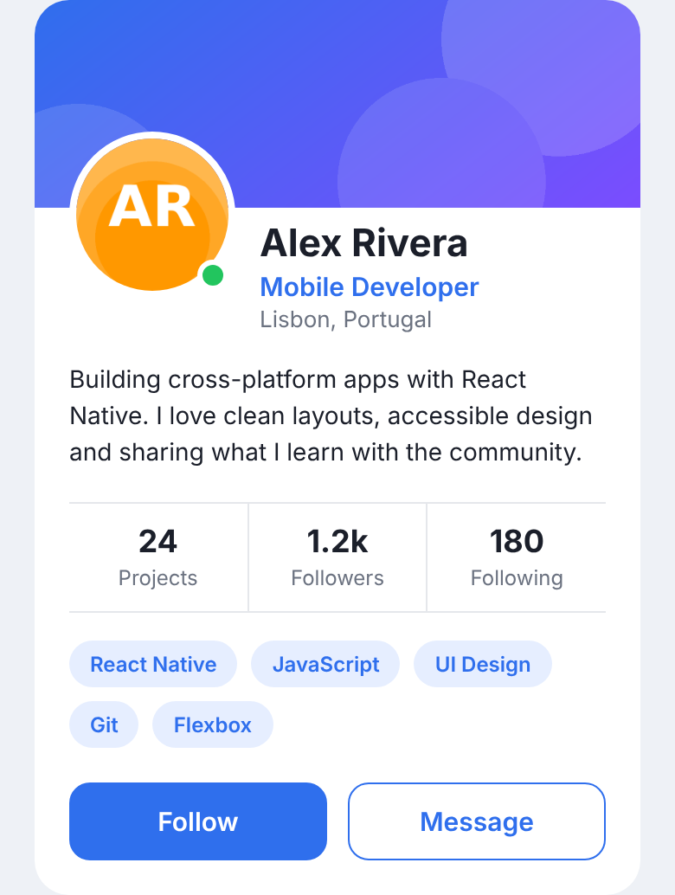

# Practical Task — Profile Card

**Topic:** Basics. Components `View`, `Text`, `Image`. Flexbox. Layouts, styling
**Duration:** about 60 minutes
**Tools:** Visual Studio Code, Node.js (LTS), the Expo Go app on your phone (or an Android/iOS emulator)

## Goal

Build a **profile card** screen like the one below, using only core React Native components (`View`, `Text`, `Image`) and `StyleSheet`.



> The picture is an approximation. Small differences between iOS, Android and your screen size are normal.

## Learning objectives

After this task you will be able to:

- Build a screen structure with nested `View` and `Text` components.
- Show local images with `Image` and control their size, shape and `resizeMode`.
- Lay out elements with Flexbox: `flexDirection`, `justifyContent`, `alignItems`, `flex`, `flexWrap` and `gap`.
- Position an element on top of another one with `position: 'absolute'`.
- Style components with `StyleSheet.create`: colors, typography, spacing, borders, rounded corners and shadows.

## Setup

1. Create a new Expo project from the VS Code terminal:

   ```bash
   npx create-expo-app@latest profile-card --template blank
   cd profile-card
   ```

2. Copy into the project:
   - `App.js` from this folder (replace the existing one).
   - The whole `assets/` folder (it contains `avatar.png` and `banner.png`).

   > If your project has `App.tsx` instead of `App.js`, delete it and keep the `App.js` from this folder.

3. Start the app and open it with Expo Go (scan the QR code) or an emulator:

   ```bash
   npx expo start
   ```

4. Open the project in VS Code (`code .`). Edit `App.js`; the app reloads when you save.

## The task

Work inside `App.js`. The data (`BIO`, `STATS`, `SKILLS`) is already defined. Build the card in **5 steps**. Check your screen after each step.

### Step 1 — Structure with `View` and `Text` (10 min)

- Keep the outer `View` (`screen`) and add a white `View` called `card` inside it, with `padding: 20`.
- Inside the card, add four `Text` elements: **name** (`Alex Rivera`), **role** (`Mobile Developer`), **location** (`Lisbon, Portugal`) and the **bio** (`BIO`).
- Show the bio on **at most 3 lines** (`numberOfLines`).
- Make the name bigger and bold (`fontSize`, `fontWeight`) and the location gray.

**Checkpoint:** you see a white card with four lines of text.

### Step 2 — Images with `Image` (10 min)

- Add the banner: `source={require('./assets/banner.png')}`, `width: '100%'`, `height: 120`, `resizeMode="cover"`. It goes at the **top of the card**, above the text.
- Add the avatar: `./assets/avatar.png`, **96 × 96**, perfectly **circular** (`borderRadius`), with a white `borderWidth` of 4.
- Make the avatar **overlap** the banner using a **negative margin**.

**Checkpoint:** a banner at the top and a round avatar that overlaps it.

### Step 3 — Flexbox: header row and stats row (15 min)

- **Header row:** put the avatar and the name/role/location texts **side by side** (`flexDirection: 'row'`). The text block must take the remaining width (`flex: 1`) and have a small left margin. The texts must start **below** the banner.
- **Stats row:** render `STATS` with `.map()`. Each stat shows its **value** (big, bold) and its **label** (small, gray), centered. The three stats must have **equal width** (`flex: 1`) and be in one row. Add a thin border above and below the row.

**Checkpoint:** avatar next to the texts, and three equal columns (Projects, Followers, Following).

### Step 4 — Layout: badge, tags and buttons (15 min)

- **Online badge:** a green circle (18 × 18, white border) placed on the **bottom-right corner of the avatar** with `position: 'absolute'`. Hint: wrap the avatar and the badge in a `View`.
- **Skill tags:** render `SKILLS` as small boxes in a row that **wraps to the next line** when there is no space (`flexWrap`), with a space between them (`gap`).
- **Action buttons:** two buttons at the bottom, **side by side with equal width** (`flex: 1`): `Follow` and `Message`. Use `View` + `Text` (there is no touch behavior yet).

**Checkpoint:** a green dot on the avatar, tags in two lines and two equal buttons.

### Step 5 — Styling polish (10 min)

- **Center the card vertically** on the screen (`justifyContent: 'center'` on `screen`) and remove the top padding.
- Create a `COLORS` object (background, card, text, muted, primary, primary-light, border, online) and use it everywhere. **No color should be repeated as a hard-coded string.**
- Round the corners: the card (20), tags (pill shape), buttons (12). The banner must follow the **top corners** of the card.
- Role in the primary color, tags with a light primary background and primary text, **Follow** filled with the primary color and **Message** with only a primary border.
- Add a **shadow** to the card. It must work on iOS and Android: use `Platform.select` (`shadow*` props on iOS, `elevation` on Android).
- Add a vertical divider between stats (merge two styles with an array: `style={[styles.stat, cond && styles.statDivider]}`).
- Improve readability: `lineHeight` for the bio and spacing between elements.

**Checkpoint:** your screen looks like the expected result.

## Checkpoint questions

Answer in a file called `ANSWERS.md` (2–3 sentences each):

1. What is the default value of `flexDirection` in React Native? How is it different from CSS on the web?
2. What is the difference between `justifyContent` and `alignItems`?
3. What does `flex: 1` do inside a row? And on the outermost `View` of a screen?
4. What is the difference between `resizeMode="cover"` and `resizeMode="contain"`?
5. Why do we use `StyleSheet.create` instead of plain objects inside the JSX?
6. Why does a shadow written with `shadowColor` not appear on Android?

## Bonus (optional, +10 points)

- Extract two reusable components with props: `StatItem({ label, value })` and `Tag({ label })`.
- Use `useWindowDimensions` so that, on a wide screen (more than 600 px), the card has a `maxWidth` of 420 and is centered.
- Add a second `View` with a *Skills* title above the tags (`textTransform: 'uppercase'`, `letterSpacing`).

## Acceptance criteria

- [ ] The app runs without errors or warnings.
- [ ] Only `View`, `Text`, `Image` and `StyleSheet` (and `Platform` for the shadow) are used.
- [ ] All styles are defined in `StyleSheet.create`; there are no inline style objects (arrays that combine styles are allowed).
- [ ] `STATS` and `SKILLS` are rendered with `.map()` and each element has a `key`.
- [ ] The screen looks correct in portrait on your phone or emulator.
- [ ] `ANSWERS.md` is complete.

## Submission (Git)

1. Create a branch: `git checkout -b task/profile-card`
2. Commit your work in small steps (one commit per step, e.g. `step 1: card structure`).
3. Push the branch to GitHub: `git push -u origin task/profile-card`
4. Open a Pull Request and add a screenshot of your app.

## Useful links

- [View](https://reactnative.dev/docs/view) · [Text](https://reactnative.dev/docs/text) · [Image](https://reactnative.dev/docs/image)
- [Layout with Flexbox](https://reactnative.dev/docs/flexbox) · [Height and Width](https://reactnative.dev/docs/height-and-width)
- [Style](https://reactnative.dev/docs/style) · [StyleSheet](https://reactnative.dev/docs/stylesheet) · [Shadow props](https://reactnative.dev/docs/shadow-props)
