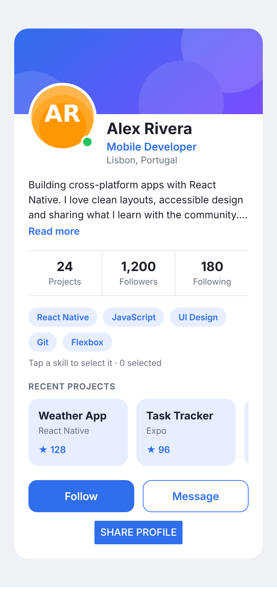
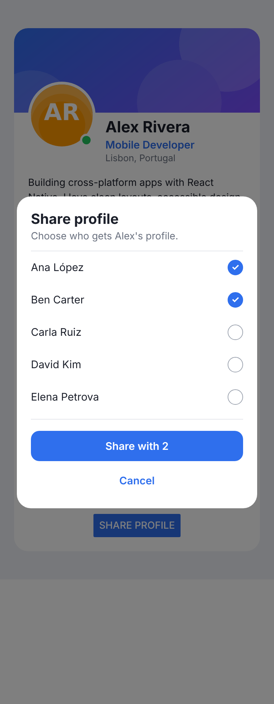

# Practical Task 3 — Modals, ScrollView and SafeAreaView

**Topic:** Modals, `ScrollView` and `SafeAreaView` in Expo
**Duration:** about 60 minutes
**Tools:** Visual Studio Code, Node.js (LTS), the Expo Go app on your phone (or an Android/iOS emulator)
**Previous tasks:** [Task 1](../../task-1/student/) (layout and styling) and [Task 2](../../task-2/student/) (events and state)

## Goal

You keep working on the same **profile card**. In this task you will:

- open a **modal** from the *Share profile* button and use it to share the profile with your contacts,
- add a **horizontal list of projects** with `ScrollView`,
- put a **vertical scrolling list** inside the modal,
- protect the screen from the notch and the system bars with `SafeAreaView`.

| Final card | Final modal |
|---|---|
|  |  |

> The pictures are an approximation. Small differences between iOS, Android and your screen size are normal.

## Learning objectives

After this task you will be able to:

- Show and hide a `Modal` with a `visible` state (`useState`) and close it in every way the user expects (button, backdrop, Android *back* button).
- Choose `animationType` and `transparent` and build a custom modal design (overlay + card).
- Use `ScrollView` for long content, both vertical and `horizontal`.
- Understand the difference between `style` and `contentContainerStyle` in a `ScrollView`.
- Keep content inside the safe area of the device with `SafeAreaView`.
- Apply best practices: modals sparingly, limited content inside a `ScrollView`, `SafeAreaView` everywhere.

## Setup

Task 3 builds on Tasks 1 and 2. This folder is a complete Expo project whose `App.js` is the **solution of Task 2 plus some new data** (`PROJECTS` and `CONTACTS`).

> If you finished Task 2 you may copy your own `App.js` and add the new data, but we recommend starting from the provided `App.js` so everyone has the same base.

1. Open this folder in VS Code (`code .`) and open the terminal (`Ctrl+\``).
2. Check that you are in the folder that contains `package.json`: `ls package.json`.
3. Install and start:

   ```bash
   npm install
   npx expo start
   ```

4. Scan the QR code with Expo Go (same Wi-Fi), or press `a` / `i` for an emulator. If the QR code does not connect, use `npx expo start --tunnel`.
5. Edit `App.js`. The app reloads every time you save.

> This project already lists `react-native-safe-area-context` in `package.json` (it is the recommended library for `SafeAreaView` in Expo). `npm install` installs it for you. If you create your own project, install it with `npx expo install react-native-safe-area-context`.

### Common problems

| Problem | Solution |
|---|---|
| `npm error enoent ... package.json` | You are in the wrong folder. `cd` into the folder that contains `package.json`. |
| `Modal` never appears | `visible` must be `true`. Check that your button calls `setModalVisible(true)` and that you did not write `onPress={setModalVisible(true)}`. |
| The modal opens by itself when the app starts | You wrote `onPress={setModalVisible(true)}` instead of `onPress={() => setModalVisible(true)}`. |
| The modal does not close with the Android *back* button | Add `onRequestClose` and make it close the modal. |
| You only see a white screen when the modal opens | Add `transparent={true}` to the `Modal`. |
| `Alert` does nothing in the browser | `Alert.alert` only works on a phone or emulator. Test on Expo Go. |
| `Unable to resolve react-native-safe-area-context` | Run `npm install` (or `npx expo install react-native-safe-area-context`) and restart `npx expo start`. |

## The task

Work inside `App.js`. Search for the `TODO` comments: each one tells you the step. Build the new features in **5 steps** and check your phone after each one.

### Step 1 — Your first `Modal` (10 min)

- Import `Modal` from `react-native`.
- Create the state `const [modalVisible, setModalVisible] = useState(false);`.
- Change the **Share profile** `Button` so that it opens the modal: `onPress={() => setModalVisible(true)}`. The old `handleSharePress` (with the alert) is not needed anymore: delete it.
- Add this modal at the end of the screen (inside the `ScrollView`, after the card):

```jsx
<Modal
  animationType="slide"
  transparent={true}
  visible={modalVisible}
  onRequestClose={() => {
    Alert.alert('Modal has been closed.');
  }}>
  <View style={{ flex: 1, justifyContent: 'center', alignItems: 'center', backgroundColor: 'rgba(0, 0, 0, 0.5)' }}>
    <View style={{ backgroundColor: 'white', padding: 20 }}>
      <Text>Hello, I am a Modal!</Text>
      <Button
        title="Close Modal"
        onPress={() => setModalVisible(!modalVisible)}
      />
    </View>
  </View>
</Modal>
```

**Checkpoint:** *Share profile* opens a dark overlay with a white box. *Close Modal* closes it. On Android, press the *back* button: you see an alert but the modal stays open (you will fix this in Step 2).

### Step 2 — A custom modal design (10 min)

Now make the modal look like the rest of your app and close it in every expected way.

- Copy the block below **at the end of** `StyleSheet.create({ ... })` (before the closing `});`). It contains **all** the new styles of this task, so you will not need to write styles in the next steps.

```js
  overlay: {
    flex: 1,
    justifyContent: 'center',
    alignItems: 'center',
    padding: 24,
    backgroundColor: 'rgba(0, 0, 0, 0.5)',
  },
  sheet: {
    width: '100%',
    maxWidth: 420,
    padding: 20,
    borderRadius: 20,
    backgroundColor: COLORS.card,
  },
  sheetTitle: {
    fontSize: 20,
    fontWeight: '700',
    color: COLORS.text,
  },
  sheetText: {
    marginTop: 4,
    marginBottom: 12,
    fontSize: 14,
    color: COLORS.muted,
  },
  sheetClose: {
    marginTop: 8,
    paddingVertical: 10,
    alignItems: 'center',
  },
  sheetCloseText: {
    fontSize: 15,
    fontWeight: '600',
    color: COLORS.primary,
  },
  sectionTitle: {
    marginTop: 18,
    marginBottom: 10,
    fontSize: 12,
    fontWeight: '700',
    letterSpacing: 0.5,
    color: COLORS.muted,
  },
  projectsRow: {
    gap: 12,
    paddingRight: 4,
  },
  projectCard: {
    width: 140,
    padding: 14,
    borderRadius: 14,
    backgroundColor: COLORS.primaryLight,
  },
  projectName: {
    fontSize: 15,
    fontWeight: '700',
    color: COLORS.text,
  },
  projectTech: {
    marginTop: 4,
    fontSize: 12,
    color: COLORS.muted,
  },
  projectStars: {
    marginTop: 12,
    fontSize: 13,
    fontWeight: '600',
    color: COLORS.primary,
  },
  contactList: {
    maxHeight: 240,
    borderTopWidth: 1,
    borderBottomWidth: 1,
    borderColor: COLORS.border,
  },
  contactRow: {
    flexDirection: 'row',
    justifyContent: 'space-between',
    alignItems: 'center',
    paddingVertical: 12,
  },
  contactName: {
    fontSize: 15,
    color: COLORS.text,
  },
  checkbox: {
    width: 22,
    height: 22,
    borderRadius: 11,
    borderWidth: 1.5,
    borderColor: COLORS.offline,
    alignItems: 'center',
    justifyContent: 'center',
  },
  checkboxSelected: {
    borderColor: COLORS.primary,
    backgroundColor: COLORS.primary,
  },
  checkMark: {
    fontSize: 13,
    fontWeight: '700',
    color: '#FFFFFF',
  },
  shareButton: {
    marginTop: 16,
    paddingVertical: 12,
    borderRadius: 12,
    alignItems: 'center',
    backgroundColor: COLORS.primary,
  },
  shareButtonDisabled: {
    backgroundColor: COLORS.offline,
  },
  shareButtonText: {
    fontSize: 15,
    fontWeight: '600',
    color: '#FFFFFF',
  },
  safe: {
    flex: 1,
    backgroundColor: COLORS.background,
  },
```

- Write a function `closeModal` that calls `setModalVisible(false)`.
- Rebuild the modal with these rules:
  - `animationType="fade"`, `transparent={true}`, `visible={modalVisible}` and `onRequestClose={closeModal}` (so that the Android *back* button closes it).
  - Replace the inline styles by `styles.overlay` (dark background) and `styles.sheet` (white card with rounded corners).
  - Inside the sheet: a title `Share profile` (`styles.sheetTitle`), a text `Share Alex's profile with your team.` (`styles.sheetText`) and a `Pressable` **Close** button (`styles.sheetClose` + `styles.sheetCloseText`, with the `pressed` style from Task 2).
  - **Close when the user taps the dark area.** Inside the overlay, *before* the sheet, add `<Pressable style={StyleSheet.absoluteFill} onPress={closeModal} />`.

**Checkpoint:** the modal fades in, looks like a card, and closes with the *Close* button, by tapping outside the card and with the Android *back* button. Tapping *inside* the card does **not** close it.

### Step 3 — `ScrollView`: a horizontal list of projects (10 min)

- Between the skills hint (`Tap a skill to select it ...`) and the *Follow / Message* buttons, add a small title `RECENT PROJECTS` (`styles.sectionTitle`).
- Below it, add a **horizontal** `ScrollView` with the projects from the `PROJECTS` array:
  - props: `horizontal`, `showsHorizontalScrollIndicator={false}` and `contentContainerStyle={styles.projectsRow}`;
  - render each project with `.map()` (do not forget the `key`) as a `View` with `styles.projectCard` containing three `Text`: the name (`styles.projectName`), the technology (`styles.projectTech`) and `★ {stars}` (`styles.projectStars`).

**Checkpoint:** below the skills you can swipe a row of project cards to the left and right. The page itself still scrolls vertically.

### Step 4 — `ScrollView` inside the modal: choose contacts (15 min)

Turn the modal into a real *Share profile* dialog.

- Add the state `selectedContacts` (an **array**, starts with `[]`) and the derived value `const isShareDisabled = selectedContacts.length === 0;`.
- Change the text of the sheet to `Choose who gets Alex's profile.`
- Under it add a **vertical** `ScrollView` with `style={styles.contactList}` (it has a `maxHeight`, so the list scrolls inside the modal) that renders `CONTACTS` with `.map()`. Each contact is a `Pressable` (`styles.contactRow`) with the name (`styles.contactName`) and a round checkbox (`styles.checkbox`, plus `styles.checkboxSelected` and a `✓` in `styles.checkMark` when selected).
- Write `handleContactPress(name)`: it adds the name to `selectedContacts` or removes it. **Do not mutate the array** (remember Task 2: `filter` / spread).
- Under the list add a `Pressable` button (`styles.shareButton`, `styles.shareButtonDisabled`, `styles.shareButtonText`) that:
  - is disabled while `isShareDisabled` is `true` and then shows `Select contacts`; otherwise shows `Share with N`;
  - calls `handleConfirmShare`, which shows `Alert.alert('Profile shared', 'Sent to: ' + names)` and closes the modal.
- Add a `Cancel` `Pressable` (`styles.sheetClose` / `styles.sheetCloseText`) that closes the modal.
- Update `closeModal` so that it **also clears** the selection: `setSelectedContacts([])`.

**Checkpoint:** you can scroll the list of 8 contacts inside the modal, select several, see `Share with 2`, share, and when you open the modal again nothing is selected.

### Step 5 — `SafeAreaView` and best practices (10 min)

- Import `SafeAreaView` from `react-native-safe-area-context`:

  ```jsx
  import { SafeAreaView } from 'react-native-safe-area-context';
  ```

- Wrap the whole screen (the root `ScrollView` and the `Modal`) in `<SafeAreaView style={styles.safe}>`. Do not forget to close it at the end.
- Review your app with this **best-practices checklist** (write the answers in `ANSWERS.md`, question 7):
  - There is **one** modal in the whole screen and it is used for a short, focused action.
  - The only long lists are `PROJECTS` (5 items) and `CONTACTS` (8 items): the amount of rendered content inside the `ScrollView` components is limited.
  - The screen is inside a `SafeAreaView`.

**Checkpoint:** on a phone with a notch the card and the status bar do not overlap, and all features of Tasks 1, 2 and 3 work together.

## Checkpoint questions

Answer in a file called `ANSWERS.md` (2–3 sentences each):

1. What does the `visible` prop of `Modal` do and why do we control it with `useState`?
2. What is `onRequestClose` for? What happens on Android if you do not close the modal in it?
3. What is the effect of `transparent={true}`? Name the three values of `animationType`.
4. Why does `ScrollView` exist? What happens with a long `View` without it? When would you choose `FlatList` instead?
5. What is the difference between the `style` and the `contentContainerStyle` props of a `ScrollView`?
6. What is `SafeAreaView` for and which zones of the device does it protect? Why do we use `react-native-safe-area-context`?
7. Write the three best practices from the Step 5 checklist in your own words and give an example of when a modal is **not** a good idea.

## Bonus (optional, +10 points)

- Add a `searchText` state and a `TextInput` above the contact list to filter `CONTACTS` while typing.
- Add a `Switch` or a selectable option *Allow comments* inside the modal and show it in the alert.
- Use `useSafeAreaInsets` (from `react-native-safe-area-context`) to read the insets and show them in a `Text` while developing (you need a `SafeAreaProvider` at the root).

## Acceptance criteria

- [ ] The app runs without errors or warnings.
- [ ] The modal opens from *Share profile* and closes with the *Close* / *Cancel* buttons, by tapping outside the card and with `onRequestClose`.
- [ ] The modal design uses `StyleSheet` (no inline styles in the final version).
- [ ] The project row scrolls **horizontally** and the contact list scrolls **vertically** inside the modal.
- [ ] `selectedContacts` is never mutated (no `push`, `splice`).
- [ ] Opening the modal again always starts with no selected contact.
- [ ] The screen is wrapped in `SafeAreaView`.
- [ ] Everything from Tasks 1 and 2 still works (follow, message composer, bio, skills).
- [ ] `ANSWERS.md` is complete.

## Submission (Git)

1. Create a branch: `git checkout -b task/modals-scrollview-safearea`
2. Commit in small steps (one commit per step, e.g. `step 4: contact list in modal`).
3. Push the branch: `git push -u origin task/modals-scrollview-safearea`
4. Open a Pull Request and add a short screen recording or screenshots of your app.

## Useful links

- [Modal](https://reactnative.dev/docs/modal) · [ScrollView](https://reactnative.dev/docs/scrollview) · [Alert](https://reactnative.dev/docs/alert)
- [react-native-safe-area-context (Expo docs)](https://docs.expo.dev/versions/latest/sdk/safe-area-context/)
- [FlatList](https://reactnative.dev/docs/flatlist) · [Updating arrays in state (react.dev)](https://react.dev/learn/updating-arrays-in-state)
